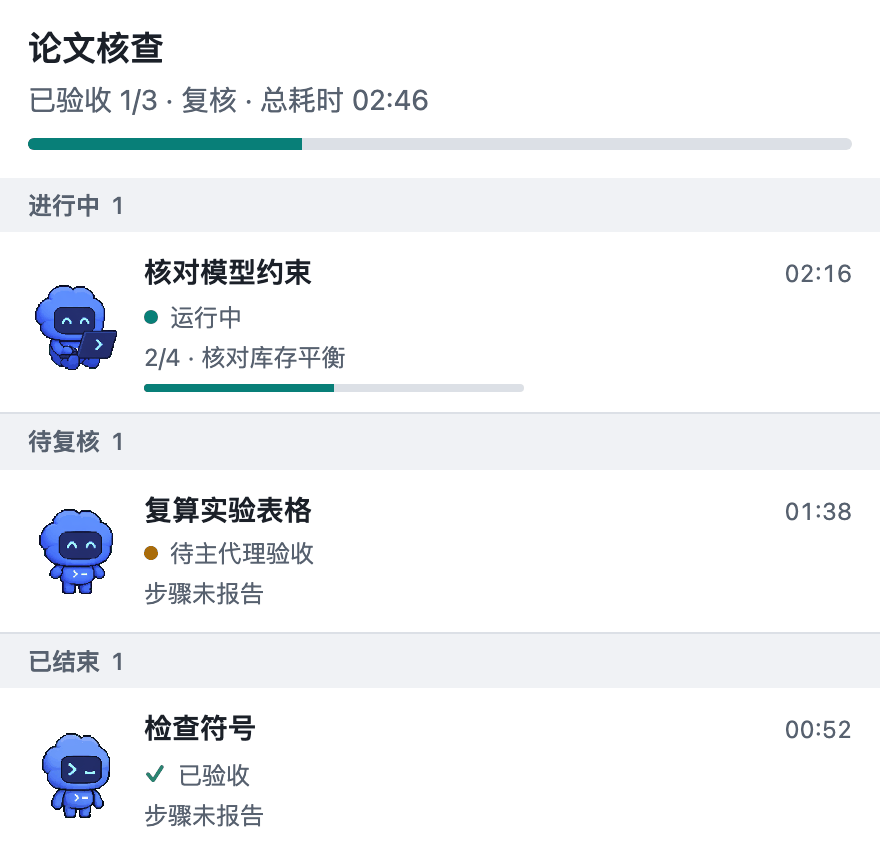

# Codex Agent Panel

在 Codex 桌面端查看每个子代理在做什么。聊天里保留一行总进度，点击 **在右侧打开**，就能一边聊天，一边查看各代理的任务、步骤、耗时和验收状态。



*上图录自插件界面，使用示例任务数据。总进度为 1/3，因为「复算实验表格」已经交付，还在等主代理验收。*

## 安装

已验证环境为 macOS、Codex 桌面端和 Codex CLI `0.167.0-alpha.4.1`。终端需能运行 `git`、`python3` 和 `codex plugin`。插件使用 Python 标准库，无需安装 pip 包。Codey 动画从本机的 `/Applications/ChatGPT.app` 读取，找不到兼容图集时仍可查看文字状态。

**1. 在终端安装插件。** 可以从任意目录运行：

```sh
codex plugin marketplace add https://github.com/ylimingtju/codex-agent-panel.git --ref main
codex plugin add savvy-progress-codex@codex-agent-panel
codex plugin list --marketplace codex-agent-panel
```

最后一条命令应显示 `savvy-progress-codex@codex-agent-panel` 为 `installed, enabled`。`savvy-progress-codex` 是插件沿用的安装 ID，界面名称是 **Codex Agent Panel**。

**2. 启用自动跟踪。** 在终端运行 `codex` 进入交互界面，输入 `/hooks`，查看并信任该插件的四个钩子：`PostToolUse`、`SubagentStart`、`SubagentStop` 和 `Interrupt`。它们用于记录派工、启动、停止和中断；未信任的钩子会被 Codex 跳过。[Codex 钩子说明](https://learn.chatgpt.com/docs/hooks#review-and-trust-hooks)

## 第一次使用

在 Codex 桌面端新开一个本地聊天，打开任意代码项目，发送下面的请求：

> 请派两名子代理并行做只读检查。一名梳理项目目录，另一名列出测试入口。把这两项登记为计划，显示子代理进度，等结果返回后逐项验收。

1. **看总进度。** 首次派出子代理时，主代理会按插件指引展示进度卡。若卡片没有出现，在同一聊天输入 **显示子代理进度**。
2. **打开右侧面板。** 点击卡片上的 **在右侧打开**，或在聊天里输入 **查看子代理详情**。同一聊天再次派工时，新卡会接替旧卡，已打开的面板会切到最新一轮。不同聊天各有自己的面板。如果面板提示配对，输入本轮卡片的只读配对码。
3. **读懂两个计数。** 代理行里的 `2/4` 表示它已报告完成四个步骤中的两个。顶部的 **已验收 1/2** 表示主代理已核查并接受两个计划项中的一个。没有上报步骤的代理会显示 **步骤未报告**。

Codey 在工作时循环播放动画，验收通过后挥手一次。开启系统的“减少动态效果”后，面板显示静态姿势。进度记录默认保存在本机的 `~/.codex/savvy-progress/state.sqlite3`。

## 卸载

```sh
codex plugin remove savvy-progress-codex@codex-agent-panel
codex plugin marketplace remove codex-agent-panel
```

卸载后，本机已有的进度记录会保留。
